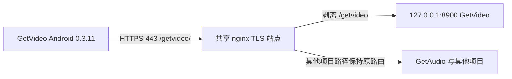

# GetVideo 公网入口迁移与运维记录

日期：2026-10-31。开发基线：GetVideo@3dccb1c；本轮迁移版本以 GitHub v0.3.11 标签核验。Android 0.3.11 (18)。

## 当前状态与边界

新入口 `https://43.142.37.199/getvideo/` 已部署且手机已适配，是当前唯一的 GetVideo 公网入口。用户确认抖音 OAuth 原本未配置，未来按新路径增加，不作为本次下线前提，并明确要求关闭旧入口。8443 已无监听、外部连接失败，用户已在腾讯云控制台确认删除其放行规则，专属续期 timer 已停用。

本轮没有清空数据库、卸载正式 App、替换签名、复制其他项目凭据或调用付费 AI 生成。公网测试使用隔离账号，测试账号及测试媒体已完成定向清理。

## 架构与路由



443 TLS 证书验证的是同一 IP，由现有站点提供。GetVideo 内部端口继续只绑定 loopback。没有创建第二个争用 443 的同名 server。

| 用途 | 对外路径 | 内部路径 | 认证 |
|---|---|---|---|
| 基础地址 | `/getvideo/` | `/` | 保留旧根路径 Basic 保护；后端没有首页 |
| 健康检查 | `/getvideo/health` | `/health` | 无账号认证，检查 app=GetVideo |
| 注册/登录 | `/getvideo/account/register`、`/getvideo/account/login` | 原 `/account/...` | 请求体手机号/密码；HTTPS |
| 当前账号/同步/提取 | `/getvideo/account/me`、`/getvideo/v2/sync`、`/getvideo/v2/extract` | 原账号与 v2 路径 | `X-GetVideo-Session` |
| 视频文件 | `/getvideo/v2/video/{id}` | `/v2/video/{id}` | 会话与账号归属校验，支持 Range |
| 平台授权 | `/getvideo/account/platform-auth/...` | 原 `/account/platform-auth/...` | 保留原账号/授权 proof 校验 |
| 抖音回调 | `/getvideo/account/platform-auth/douyin/callback` | 原 callback | 无 Basic 门禁；state/code 由原业务处理 |
| AI 上传/素材 | `/getvideo/v2/recreations/...` | 原 `/v2/recreations/...` | 原会话与账号权限 |
| 旧业务接口 | `/getvideo/tracks` 等 | 原 `/tracks` 等 | 保留 GetVideo Basic 保护 |

完整请求参数、响应、状态码及错误码沿用 [HTTP API 文档](http-api.md)，只是在基础地址后增加项目路径。注册/登录业务账号与旧接口 Basic 账号仍为两套机制；新 APK 不保存 Basic 密码。

## nginx 配置

- 仓库模板：`deploy/tx-https/getvideo-path.conf`。
- 部署位置：`/etc/nginx/snippets/getvideo-path.conf`。
- 在现有 `/etc/nginx/sites-available/getaudio` 的 443 server 中增加一行 include。
- `location ^~ /getvideo/` 防止其他项目的同级正则 location 捕获 GetVideo 请求。
- 子 location 必须分别声明 rewrite 与 proxy_pass；只写 auth_basic off 会缺少内容处理器并返回静态文件 404，已在公网检查中发现并修正。
- 新入口覆盖 `X-Forwarded-Prefix: /getvideo`；旧入口所有转发分支清除客户端传入的前缀头。
- 保留 240 秒代理读取超时、关闭响应缓冲、AI 上传 256 MiB 上限及关闭上传请求缓冲。回调 location 关闭 nginx access_log。
- 旧 8443 站点和专属续期模板已从当前部署模板移除，原线上配置只在服务器私有备份归档，不启用。

`getvideo/public_path.py` 根据本机代理注入的固定前缀设置每个 ASGI 请求的 root_path/path/raw_path，支持新路径的重定向和接口文档；旧入口不带前缀仍可用。后端仅在 loopback 监听是该代理头信任边界的前提，不能直接把 8900 暴露到公网。

`accounts.protect_account_ids` 按去除 root_path 后的业务路径判断新旧接口；回调访问日志过滤同时处理带前缀与不带前缀的路径，移除查询参数。

## Android URL 与数据兼容

- `ServerConnectionPolicy.kt`：默认地址改为新入口，仅将确定的官方旧入口映射到新入口；自定义服务器和显式空地址保留。
- `ServerProbe.kt`：允许基础地址包含路径；健康检查追加 `health`，同时校验响应确实来自 GetVideo。
- `serverResourceUrl`：统一处理视频、恢复原版、旧二维码、AI 素材地址。JSON 中已有 `/v2/...` 等路径仍按“服务内部根路径”解释，拼到配置的服务基础地址后；也兼容已带 `/getvideo/` 的地址，避免双重前缀。禁止跨域、路径穿越及编码分隔符。
- 不使用 `base.resolve("/v2/...")`；该写法会丢掉项目路径。普通 Retrofit 注解继续使用不以 `/` 开头的相对路径。
- `isCredentialOrigin` 同时检查 HTTPS、主机、端口与服务路径边界；网络拦截器每一跳先移除凭据，再按目标重新决定是否添加会话。GetVideo 凭据不得发给共享主机的其他项目。
- `AccountStore`：读取旧加密会话时规范化官方地址，再用 AtomicFile 原子保存。直接 openRead 以支持 Android 8 只有 .bak 文件时的恢复。密码仍不保存。
- `serverIdentityUrl`：将新旧官方地址映射到历史旧身份，仅用于数据标识，不用于联网。Room 云端 scope、游标、媒体 ID、AI 缓存与 Agent 回执文件名因此保持不变，无需升级 Room schema 或批量重写数据库。
- `FailureOutbox` 用规范化后的地址匹配旧报告，仍保留 owner 限制。任意自定义地址或其他项目不会共享身份。
- 逻辑映射每次读取均生效；进程在会话文件重写前退出，也不会造成设置和 Room 身份一半迁移。没有保存迁移后的明文会话副本。

## 平台授权

B站：用户已在真实手机扫码确认，新入口返回成功，App 显示凭证有效且已保存；原绑定和其他平台数据保留。

抖音：能力接口返回 available=false，该功能原本未配置。用户明确确认未来在新入口下增加，不要求为此保留旧端口。开放平台配置、白名单登记和真实完整 OAuth 流程仍未完成；不得用 callback 返回 422（无 state 参数）代替真实授权成功。

后续具备平台配置时，服务端 `GETVIDEO_DOUYIN_REDIRECT_URI` 与开放平台登记必须同时改为：

```text
https://43.142.37.199/getvideo/account/platform-auth/douyin/callback
```

配置变量及授权细节参考 `.env.example` 和 `getvideo/platform_accounts.py`；不在文档中记录 client secret、Cookie 或会话。

## 验证证据

| 项目 | 结果与边界 |
|---|---|
| GitHub 同步 | main=3dccb1c，本机原工作区干净；TX 从 b4d80ef 快进至同一基础提交 |
| Android 自动检查 | 91 项单测通过；Lint 0 errors / 25 warnings；debug 单测、正式 release 和同签名 AndroidTest 构建通过 |
| 服务端自动检查 | TX 210 项通过，1 条既有 Starlette/httpx 弃用警告 |
| 本机 Python 基线 | FFmpeg 无 chromaprint，原指纹测试失败；其余 206 项基线通过。不能描述为本机全绿 |
| 真实手机 | ADB 17ead82e，型号 23013RK75C；原 0.3.10 (17) 同包同签名覆盖升级为 0.3.11 (18) |
| 会话与同步 | 原会话经新入口认证、同步完成，5 个已有媒体文件长度保持，账号未切换 |
| 注册/登录 | 公网及手机网络测试均通过；手机使用隔离测试账号，未退出或替换用户原账号 |
| 提取与媒体 | B站真实服务端提取；手机从新入口下载并核对 SHA-256、字节数、206 Range；下载文件在手机播放进度推进；手机直接提取与播放也通过 |
| AI 资源路径 | 仅测试合成 1 秒素材上传和下载哈希，无付费模型调用、无生成任务重复提交 |
| B站授权 | 新路径生成二维码、用户扫码确认、凭证保存并显示有效 |
| 抖音 OAuth | 原本未配置，真实授权不可验证；用户已确认不再作为本次下线前提 |
| 跨项目隔离 | GetAudio 拒绝 GetVideo 会话；新 GetVideo 健康接口正常，旧 8443 已关闭 |
| 其他服务 | 原共享站点路由保留；GetAudio 新旧健康路径均 200。Paperdrift HEAD 为 200/405，Mihomo 受保护路径为 403/404，仅证明基础路由响应，未冒充其他项目全功能验收 |
| 独立审查 | 两轮只读审查；发现问题已修正，最终未发现双入口交付阻断问题 |

真机验证入口：`PublicPathInstrumentation` 检查原会话/同步/本地播放；`PublicPathNetworkInstrumentation` 检查隔离账号的注册/登录/提取/下载/播放。测试包已移除，正式 App 保留。

```bash
# macOS 本机；Gradle 需要可写入 ~/.gradle
cd android
./gradlew testDebugUnitTest lintDebug assembleRelease --offline --console=plain
# 需要再次真机验收时才构建、安装测试包；勿重复创建测试账号
./gradlew assembleReleaseAndroidTest -PgetvideoTestBuildType=release \
  -PgetvideoTestRunner=com.getvideo.app.PublicPathInstrumentation --offline --console=plain
```

正式签名要求见 [签名说明](android-release-signing.md)。交付包 `artifacts/getvideo-0.3.11-release.apk` 与同目录 `.sha256`；固定证书 CN=GetVideo，SHA-256 9d58feae04c21e02e62413b61422c7efd57b27c33d12ef8c2fe7d61a092b7337。

## 备份、回滚与下线

服务器私有备份：`/home/ubuntu/project/GetVideo-backups/https443-20261031T142730Z`，含代码归档、原 nginx 配置、SQLite 一致性快照和私有环境配置；不可对外复制或输出。

**入口故障处理**：新路径已是唯一公网入口，不能只撤除其 include。优先修复或恢复 GetVideo 自己的 snippet，`nginx -t` 后 reload；不要整份覆盖共享 getaudio 配置，避免撤销其他项目独立变更。不要回滚数据库来撤销入口变更，也不要在未经用户另行要求时恢复旧公网端口。

**App 问题处理**：优先修复并同签名升级；不卸载、不清数据。新旧身份等价映射必须保留；旧 APK 读取新保存的地址可能无法工作，不以降级替代经验证的数据恢复。

**2026-10-31 最终下线记录**：用户明确要求删除 8443，并确认未来抖音 OAuth 使用新路径。

1. 移除 `/etc/nginx/sites-enabled/getvideo`；原站点配置归档至服务器 `GetVideo-backups/retire8443-20261031T151742Z`，不再留在 sites-available 中。
2. `nginx -t` 后 reload 成功，服务器 `ss -lnt` 确认无 8443 监听，8900 仍为 loopback。
3. `getvideo-cert-renew.timer` 已 disabled/inactive；专属 renew service 已停止。443 的共享证书续期保留。
4. UFW 本身 inactive；腾讯云 8443 放行规则由用户手动删除并确认完成，没有冒充已从控制台独立回查。
5. 本机直接外部连接 8443 超时（HTTP 000）；新 `/getvideo/health` 与 GetAudio `/getaudio/health` 正常。GetAudio 的旧根 `/health` 已被独立任务改为 404，本任务未改动。

现已完成本项目“只保留新路径”的公网入口迁移。旧地址常量仅用于升级时的数据身份兼容，不用于联网，不代表仍有旧公网入口。

## 发布交付

用户已要求将本轮改动合入 main 并发布 v0.3.11。安装包版本 0.3.11 (18)，文件名 getvideo-0.3.11-release.apk，固定发布证书签名；GitHub Release 附 APK 和 SHA-256 校验文件，发布是否完成以 GitHub 实际页面为准。旧模板删除后，部署权限测试已切换到 getvideo-path.conf，完整服务端回归重新验证。
