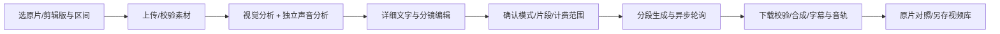

> 这是实现前的设计草案，部分长期目标尚未实现。0.2.0 实际交付范围、运行方式和限制以 [AI 重建说明](ai-recreation.md) 为准。

# GetVideo：视频详细描述与相似视频生成方案

日期：2026-10-18（北京时间）；助手：Codex。实际分析基线：GetVideo@9996b13，工作区原本干净。本文及 docs/prompts/ 为本轮未提交的设计稿，不表示功能已经实现或部署。用户本轮要求核对两家 API、选型、考虑交互并完善提示词；先交付可评审方案。没有修改服务端或 APK 的运行代码，没有重启服务，没有写入飞书。

## 更新：完整型号核验已找到可用生成模型

2026-10-18 后续逐型号核验发现 **doubao-seedance-1-0-pro-fast-251015 已实际生成并下载约 5 秒 480p 视频**，当前可以用它实现文字生视频。下文首轮探测表和“未获得任何视频任务 ID”的段落保留为当时记录，不能当作最新的全型号结论。腾讯 25 个生成型号中，24 个明确返回额度/后付费拒绝；优图人像驱动只返回参数错误，仍未确认。完整清单和探测方式见 [视频模型调用能力核验](video-model-access-audit-2026-10-18.md)。

当前建议：Seed 2.1 Pro 做视觉描述、需要时用 Seed 2.0 Mini 分析声音，Seedance 1.0 Pro Fast 做生成。该生成型号本轮仅完成纯文字出片实测，不能直接套用 Seedance 2.5 的原视频参考能力，也不能推断本次调用免费。

## 目标与可达到的效果

保留用户提出的完整路径：原视频提取成功后，实际读取视频，输出可编辑的详细文字描述，再据此生成新视频。描述不是概要，而是带时间轴的分镜、主体外观、动作、空间、机位、光色、材质、字幕及声音记录。

“几乎一样”是优化目标，不能作为当前模型的保证。纯文本把画面变成有损描述，难以完整保留人物具体外观、小物体、细微运动、手部接触、可读文字或长视频连续性。相似度优先时，建议在文字之外显式提供原片参考或首尾关键帧。界面保留纯文字实验模式，不能把参考重建或直接复用原片冒充“完全由文字生成”。

## 两把 key 的实际检查

共享凭据位置和使用权限已按 /home/ubuntu/AGENTS.md 核对；仅在当前测试子进程内读取。本文不包含任何密钥、账号标识或素材下载令牌。

- 火山方舟：共享 ARK_API_KEY；/models HTTP 200，列表包含 Seed 2.1 Pro、Seed 2.0 Mini、Seedance 2.5/2.0。模型列表是目录，不等于开通权限。
- 腾讯 TokenHub：共享 TENCENT_API_KEY / TENCENT_BASE_URL；/models HTTP 200，列表包含 Kimi K3、混元视觉视频、Kling V3/Omni、HY Video 等。没有换用国际站地址或把国内 key 发到其他平台。

实测使用本地 FFmpeg 制作的 4 秒合成 MP4：640×360、24fps、深蓝灰背景、一个红色正方形沿水平方向由左向右匀速移动，固定镜头，持续 440Hz 测试音，无人物、字幕或语音。没有上传用户手机原片。以下测试只证明该样例上的能力，不是复杂真实视频质量排名。

| 平台/模型 | 实测 | 结论 |
| --- | --- | --- |
| Ark doubao-seed-2-1-pro-260915 | 原生 video_url/Base64，HTTP 200，约 3.96 秒；识别红色方块、背景、位置变化和固定镜头 | 可作为主视觉描述模型；本次模型目录只声明 text/image/video 输入，音轨另行实际分析 |
| Ark doubao-seed-2-0-mini-260428 | 同样输入，HTTP 200，约 1.95 秒；另一次音轨分析 HTTP 200，约 1.53 秒，usage 含 audio_tokens | 可作为音轨分析及低成本视觉方案；声学描述出现“持续”与“短促”措辞不一致，仍需核对，不能声称精确还原声音 |
| TokenHub kimi-k3 | HTTP 200，但 1200 输出 token 全用于 reasoning，content 为空 | 认证/请求有响应，不算描述成功；需调整推理/输出预算后复测，不作为当前已验证主链 |
| Ark doubao-seedance-2-5-260628 | 最短 4 秒、480p 文生请求返回 HTTP 404 / ModelNotOpen，无 task_id | 当前账号未开通；未生成视频 |
| Ark doubao-seedance-2-0-260128、fast、mini | 同样返回 ModelNotOpen，无 task_id | 当前账号未开通；不能静默作为已可用后备 |
| Ark doubao-seedance-1-5-pro-251215 | 返回 InvalidEndpointOrModel.NotFound，无 task_id | 当前 key/项目下无法解析调用，不据此断言模型已下线 |
| TokenHub kling-video-v3-omni | 3 秒、720p 文生请求返回 HTTP 402 / 401007，无 task_id | 服务没有可用免费额度，且未开启后付费；需在 TokenHub 在线推理中开启相应服务计费 |

截至本次检查，没有获得任何视频生成任务 ID，因此没有生成完成、质量或收费金额的实测结论。语言/视觉测试可能产生少量模型调用用量；没有修改两家账号的开通、后付费或充值设置。

## 建议选型

1. 视觉详细描述：Seed 2.1 Pro（doubao-seed-2-1-pro-260915），传实际视频，支持结构化输出。默认按镜头分析；细节模式增加抽帧密度、额外检查关键帧，但明确抽帧分析不是每帧都看过。
2. 音轨描述：Seed 2.0 Mini（doubao-seed-2-0-mini-260428），实际处理内嵌音频；与视觉描述分别存储，再按时间轴合并。保留原声时不要求另一模型从描述中重新猜测声音。
3. 视频生成：优先候选 Seedance 2.5（doubao-seedance-2-5-260628），参考视频能力适合相似度优先；需先由账号持有人开通，再用真实样例验证。第二候选 Tencent Kling V3 Omni（kling-video-v3-omni），需开启对应后付费，验证国内 TokenHub 的具体素材组合和任务查询协议。
4. 不强行同时调用所有候选模型。默认一次主模型分析；用户选择“交叉复核”时才增加第二个模型，显示额外调用。生成端失败不自动换更贵模型，更不能因失败改成低保真纯文字而仍标“参考重建成功”。

选择理由是已测的输入能力、可控的时序/参考接口和现有项目技术栈，不是已做过生成质量的横向排名。当前模型资料显示 Seedance 2.5 支持单个参考视频 2–30 秒，Kling Omni 的输出通常是 3–15 秒；这些是单次模型限制，不是 App 对整片长度的承诺。长片必须分段，而非静默取前几秒。参考模式对素材中的真人人脸等有平台级限制；被拒绝时显示原因，不绕过或把模式悄悄降级。

## 前端交互

入口放在每条视频的操作菜单：“AI 描述与重建”。新页面包含三个可恢复的阶段：

1. **原片与分析**：原片预览、完整视频/指定区间、实际时长、视觉/声音选项、模型名称、是否要跨模型复核。点击“解析成详细文字”才上传并调用模型。用户可看到素材将发给哪家平台。
2. **详细描述与分镜**：上方原片，下方按时间轴展示镜头卡片；点时间点回看原片。可以切换完整文字与分镜表，编辑角色外观、动作、机位、背景、字幕/声音，原始版本保留。看不清和互相矛盾的项目突出显示，支持只重分析选定镜头。
3. **生成与对照**：纯文字 / 首尾帧 / 原片参考三种模式；显示输出时长、画幅、720p/1080p、声音处理方式、生成段数和模型计费说明。默认先做用户指定的一个短片段样片，用户主动点“生成全部”才跑完整视频。生成后按同一时间轴切换原片与结果、并排或交替播放；支持只重生成不满意的某段，保存到视频库或导出。

页面关闭后任务继续由服务端跟踪；重新打开恢复原状态。没有真实进度时显示“排队/生成中”，不伪造百分比；可以显示已完成片段数。取消与失败说明区分“停止后续片段”和“平台已开始计费的当前任务不保证可撤销”。

明确保留原件、描述版本和生成历史。新视频另存新记录，以生成任务作为来源，并标明 AI 生成与使用的参考模式；收藏、类别、播放列表由用户决定，不覆盖原视频。

## 服务器与 APK 的数据路径

手机已有的本地/剪辑视频不一定在服务器上。必须上传用户实际选中的文件，不能用原分享链接重新抓一次就假定等同于本机剪辑版，也不能把只有文字元数据的记录当作视频输入。

拟议流程：

- 按当前账号隔离素材、描述、片段和结果；后端以当前会话用户作为 owner，不能信任客户端传 owner。
- 针对上传单独配置 nginx location 的 body 大小与应用层上限；当前全局 client_max_body_size=1m 不足以传视频。支持流式上传、文件校验和中断恢复，拒绝超限文件，不把整段数百 MB 视频一次读入进程内存。
- 使用 ffprobe 获取真实时长、宽高、旋转、帧率及音轨；按模型的像素、帧率、体积和时长约束准备分析/参考副本，原件保留。不要用视频模型返回的画面猜这些元数据。
- 给外部生成模型的素材使用短期、单素材作用域的签名 URL 或提供商 Files/素材服务；不附带 GetVideo 会话，也不把原始私有视频开放成永久公开链接。URL 的过期时间覆盖实际平台抓取窗口，任务完成后按策略清理。
- API key 仅通过各自受限 EnvironmentFile 注入指定后端进程。不能在 APK 放 key、直接从手机调用收费厂商接口，或复用 GetAudio 数据和凭据。
- 描述和生成任务落库，独立工作进程执行耗时调用。不要占用手机连接等待几十分钟，也不要靠仅存在内存里的 FastAPI BackgroundTasks 作为持久任务队列。
- 任务记录实际 provider/model、提示词版本、输入哈希、用户编辑版本、外部 task_id、原始状态和用量。客户端/日志不返回密钥、厂商下载签名或媒体 Base64。

## 拟议 API 与存储

新增账号鉴权路由，而非改变旧提取语义：

- POST /v2/recreation-assets：上传选中素材，返回资产 ID 和媒体事实。
- POST /v2/recreations：创建分析任务（资产 ID、源区间、分析配置、客户端幂等 ID）。
- GET /v2/recreations、GET /v2/recreations/{id}：历史、任务状态、描述版本和片段状态。
- PUT /v2/recreations/{id}/description：保存编辑版本，带预期版本号，防止覆盖另一端修改。
- POST /v2/recreations/{id}/generations：由已确认的描述快照创建样片或整片任务，带模式、输出参数和幂等 ID。
- POST /v2/recreations/{id}/cancel：停止尚未提交的工作；已提交平台任务能否取消按平台能力处理。
- POST /v2/recreations/{id}/segments/{segment_id}/retry：显式重试单段，展示可能再次计费。
- POST /v2/recreations/{id}/save：成功视频另存到当前账号视频库，接入既有下载和增量同步。

新增模型：RecreationAsset、RecreationProject、DescriptionVersion、GenerationRun、GenerationSegment。分析与每次生成分开记录，一份文字可以生成多次，不将“修改文本”覆盖已经提交任务的输入快照。

拟议状态：uploaded → analyzing → review_ready → submitting → queued/running → downloading → composing → succeeded；另有 failed、cancel_requested/canceled 和 submission_unknown。

尤其注意：提交请求超时不代表平台没接单。已获得 task_id 时只重查，不再次创建任务；响应丢失或进程在平台接单后崩溃时进入 submission_unknown，使用平台幂等/自定义任务 ID 查询对账，不能自动重发造成重复计费。GET 状态查询不触发收费重提交。

## 高相似度的关键实现细节

- 尽量在原镜头边界分段，长镜头再按上限和稳定动作点切段；保留全片主体/道具注册表及每段起止状态，避免服装、物体数量和方向漂移。
- 视觉分析可先进行全局低密度扫描，再对运动密集、短镜头、细小文字区域补充高密度观察。用户看到实际分析范围，失败段不以一句摘要替代。
- 对每段明确传入原片时间、模型本地时间与偏移；不能把整片绝对时间原样放进 5 秒片段，导致动作时序错位。
- 准确字幕在生成底图后按确认时间轴合成；声音可选复用原音轨、重新生成或静音，并诚实显示这是后期复用还是生成能力。
- 原片与生成片分别检视；先核对时长、画幅、帧率、文件完整性，再比较主体、构图、动作和时序。可选视觉模型做差异清单；没有标定的数据不能显示虚假的“98%还原”。
- 分段合成做音画时间轴检查和时长容差检查；不得默认变速、补黑帧或重复原视频来伪造等长。异常留给用户确认或单段重试。
- 原始水印、文字和素材限制由现有提取/生成服务的实际能力决定，不承诺任何作品都可做到逐帧一致。

## 提示词交付

- [视频→逐镜头描述及音轨描述](prompts/video-to-description.md)：System/User 模板、结构化字段、时间轴、连续性、未知项和合并规则。
- [文字→视频及复核](prompts/description-to-video.md)：确定性编译模板、三种输入模式、每段动作/机位/外观约束、声音/字幕处理和对照复核。

这些是可直接用于后续接口实现的初稿，不代表已在真实样片上证明“接近原片”。需用多种实际内容验证：静物、横/竖屏人物动作、多镜头、可读字幕、对白、复杂运动和长片衔接；每种至少同时比较纯文字与参考模式。

## 实施顺序与验收

1. 完成素材上传、真实视频/音频分析、可编辑分镜和任务历史；当前 Ark key 可用于验证该半链路。
2. 账号持有人开通 Seedance 或腾讯对应视频模型，先用最短测试素材验证提交→轮询→下载成功及计费，再决定默认模型。不能为了接通接口自行开启后付费。
3. 接入短样片三种模式，加入描述快照、幂等、持久任务、断线恢复、保存/导出；用户检视实际细节效果。
4. 进一步接入长片分段、片段重试、字幕/音轨合成和原片对照。
5. 运行账号隔离、上传限制、失效签名、描述版本冲突、时长分段边界、厂商错误映射、重复点击/提交不确定、重启恢复、轮询恢复及合成校验测试；保留原项目服务端/Android 回归与 APK 构建。
6. 真机验收：本机与云端视频、剪辑版上传、字幕编辑、从分析到生成保存、跨账号不可见、网络断开重进和长片分段。构建通过不能代替该验收。

本轮未更改服务端/APK代码，因此未重跑代码测试或构建；模型目录和合成素材的真实 API 探测结果见上表。生成端未创建任务的前提下，不能声称端到端已验收。

## 官方资料

- 火山视频理解：https://docs.volcengine.com/docs/ark/video-understanding?lang=en
- 火山 Chat API（视频/音频结构与抽帧）：https://docs.volcengine.com/docs/ark/chat-api?lang=en
- 火山 Seedance 2.5：https://docs.volcengine.com/docs/ark/seedance-2-5?lang=zh
- 火山创建生成任务（参考素材、时长、分辨率及平台限制）：https://docs.volcengine.com/docs/ark/create-video-generation-task-api?lang=zh
- 腾讯 TokenHub 视频理解：https://cloud.tencent.cn/document/product/1823/136957
- 腾讯 TokenHub Kling 接入与参数参考（官方国际站文档；本轮请求实际使用国内 base URL）：https://intl.cloud.tencent.com/zh/document/product/1300/83714
- 腾讯后付费开通位置（来自国内服务本轮真实错误响应）：https://console.cloud.tencent.com/tokenhub/inference

飞书归档建议：《GetVideo 视频描述与相似视频生成方案》，范围为模型实测、交互、任务架构、提示词和验收；目标目录拟为“GetVideo/技术文档”，先核对并优先复用已有项目目录；使用 luochen 用户身份和实际 Codex profile。用户明确确认标题/范围/具体目录与身份后再写入。
